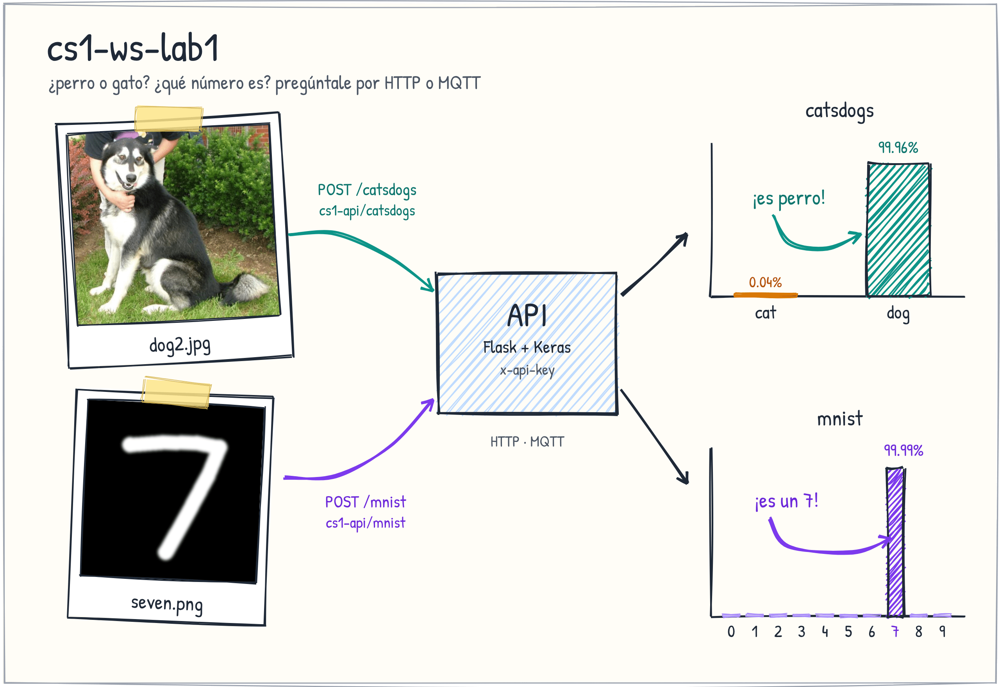

<p align="center">
  
</p>

API de clasificación de imágenes (dígitos MNIST y gato/perro) accesible por **HTTP** y **MQTT**, con los modelos en Azure Blob Storage y desplegada en una Azure VM.

| Protocolo | URL |
| :--- | :--- |
| HTTP | `https://<HOST>` |
| MQTT | `mqtt://<HOST>:1883` (sin usuario) |

## HTTP

| Método | Endpoint | Cabecera | Body (`multipart/form-data`) | Descripción |
| :--- | :--- | :--- | :--- | :--- |
| `GET` | `/health` | — | — | Estado del servicio |
| `POST` | `/mnist` | `x-api-key` | `image` (archivo, máx. 10 MB) | Reconoce un dígito (0-9) |
| `POST` | `/catsdogs` | `x-api-key` | `image` (archivo, máx. 10 MB) | Probabilidad de gato o perro |

```bash
curl -H "x-api-key: <API_KEY>" -F "image=@cat.jpg" https://<HOST>/catsdogs
```

## MQTT

Los topics siguen las rutas HTTP. La API key no se envía; la pone el servidor.

| Equivale a | Publicar en | Escuchar en |
| :--- | :--- | :--- |
| `POST /mnist` | `cs1-api/mnist` | `cs1-api/mnist/response` |
| `POST /catsdogs` | `cs1-api/catsdogs` | `cs1-api/catsdogs/response` |

Payload: bytes de la imagen o texto Base64 (máx. 10 MB). Suscríbase a la respuesta **antes** de publicar.

```bash
mosquitto_sub -h <HOST> -t "cs1-api/+/response"
mosquitto_pub -h <HOST> -t cs1-api/catsdogs -f cat.jpg
```

## Respuestas

| Endpoint / topic | 200 OK |
| :--- | :--- |
| `mnist` | `{"digit": 7, "confidence": 0.9845}` |
| `catsdogs` | `{"cat_percent": 12.34, "dog_percent": 87.66, "message": "This image is 12.34% cat and 87.66% dog."}` |

| Código | Motivo |
| :--- | :--- |
| `400` | Falta el campo `image` o la imagen es inválida |
| `401` | API key inválida o ausente |
| `413` | La imagen supera 10 MB |